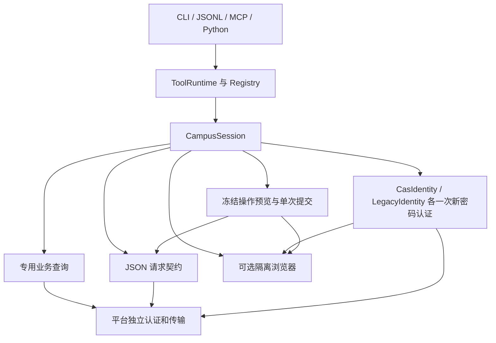

# 架构与扩展

## 一次任务

`ToolRuntime` 持有加载后的能力注册表，首次业务请求才创建 `CampusSession`。CLI、单次 JSON 每次任务结束即清理；持续 JSONL 和 MCP 在多次工具调用间保留同一个任务，直到 reset 或进程结束。

认证复用的是本次新 CAS 身份或独立微人大身份。各 HTTP 平台保持独立 Cookie/token；浏览器建立新的非持久化 context，各站点按浏览器 origin 隔离存储，通过观察到的 CAS 登录跳转申请服务票据。通用平台可把本任务 HTTP Cookie 导入各自同源的新 context，并让当前回调页面保存新 token。分域平台的前端和 API 各持独立 Cookie；一次性 code 的已验证响应只向该页面的精确交换请求重放一次。公开 profile 跳过认证。不会导入旧登录态，也不从浏览器提取密码。

MCP 使用官方 Python SDK 2.3.0 的 stdio 协议，业务调用串行送到一个专用线程，保持 Playwright 的线程归属和一次任务的执行顺序。没有后台网络服务、数据库或自研 JSON-RPC 实现。JSONL 不依赖 MCP SDK。

## 模块职责

| 模块 | 职责 |
|---|---|
| `contracts.py` | 原有能力与 JSON 扩展的统一注册、验证、类型化模板、响应检查、结构指纹 |
| `engine.py` | 任务会话、客户端复用、批处理、发现、动作调度、清理 |
| `operations.py` | 已登记的请求使用目标平台认证和签名，支持 CAS/OAuth/微人大 profile、回调凭证绑定和 JSON/HTML 响应 |
| `discovery.py` / `urls.py` | 当前门户分组、权限范围、业务链接和诊断链接 |
| `pagination.py` / `parsing.py` | 有界自动翻页、HTML/嵌入 JSON 提取 |
| `legacy.py` / `opac.py` | 独立微人大验证码与 OAuth、OPAC 多级回调 |
| `future_classroom.py` / `party_school.py` | 联合认证与账号绑定状态检查、党校编码账户回调；业务读取仍用 JSON 契约 |
| `actions.py` | 参数冻结、五分钟有效期、单次消费 |
| `browser.py` | 页面、iframe、控件引用、精确只读请求规则、CAS 桥接、受控提交 |
| `source.py` | 公开当前 HTML/JS 的文本和哈希检查 |
| `tools.py` / `server.py` | 一份工具执行实现，以及单次、JSONL、MCP 传输 |
| 各平台适配器 | 平台认证、签名，以及需要业务语义的查询 |

静音舱连续空档、成绩评教限制、本人排名过滤和体育时段解释仍由专用适配器承担。通用契约处理简单接口，不重新实现这些规则。图书馆和体育的签名传输已经抽出供两条路径复用。

适配器可提供认证后确定的 `context` 标量；契约用 `$context` 引用本人 ID 和组织 ID，调用参数不能覆盖它们。`Registry.profile_for_url` 按入口和页面路径选择最具体的配置，门户分组和浏览器使用同一规则，同源公开目录不会误选个人账户登录。只有公开配置的源站在只读浏览器中禁止发起 CAS 认证。

## 状态与作用域

| 状态 | 保存位置 | 生命周期 |
|---|---|---|
| 学号密码 | 用户明确指定的包外文件；使用时短暂进入内存 | 认证后释放运行时引用 |
| TGT、业务 Cookie/token、签名 key | 本次任务内存 | reset/退出清理，尝试撤销 TGT |
| 浏览器页面和站点存储 | 非持久化 context | reset/退出关闭 |
| 动态契约 | Registry 内存 | 当前服务进程；持久复用需保存 JSON |
| 操作计划 | ActionPlans 内存 | 5 分钟、一次消费、reset 清理 |
| API 映射 | 本次教务客户端内存 | 本次任务 |
| 能力与平台状态 | `tools/` JSON | 显式维护 |
| 证据 | `evidence/` | 仅数量、协议结构、时间与状态 |

未启用写操作的服务不会发送已登记的写契约。浏览器只读路线也不按 HTTP 方法猜测；未知请求会出现在诊断中，待 agent 核对来源后登记。注册契约是执行前的数据配置，由 agent 负责核实业务语义；远程网页内容不会自行注册权限。

## 依赖选择

核心继续用 Python 标准库；图书馆 AES/HMAC 复用 `cryptography`。可选 MCP 使用 [官方 Python SDK](https://github.com/modelcontextprotocol/python-sdk)，避免维护自定义协议兼容层。可选浏览器采用 [Playwright](https://playwright.dev/python/docs/api/class-browsercontext)，复用隔离 context、iframe、控件句柄和网络拦截，不引入另一个 agent 框架。

这两项仅在对应功能启用时导入。普通 HTTP 查询和 JSONL 不需要安装 MCP 或 Chromium。扩展步骤、格式和具体边界见 [EXTENDING](EXTENDING.md)。
