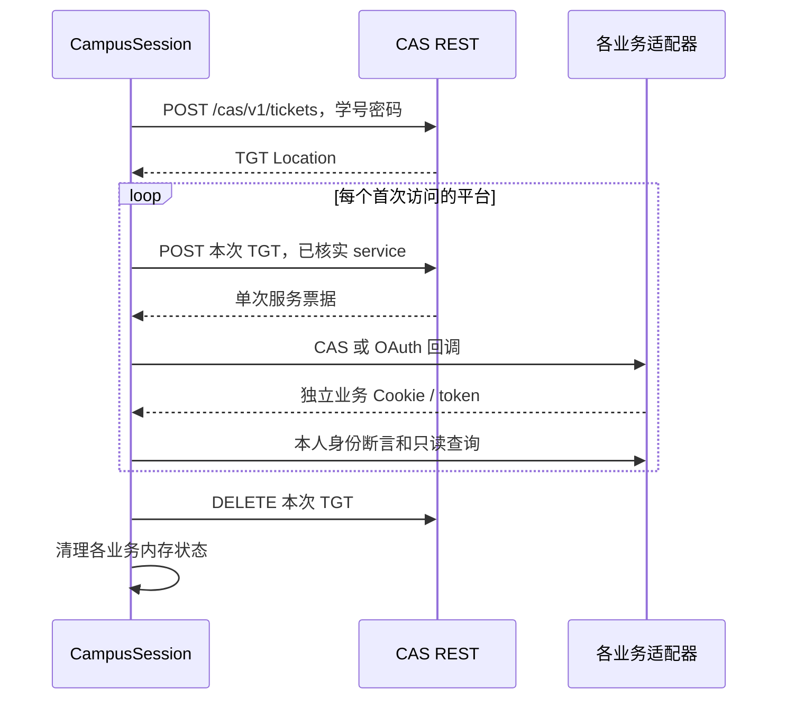

# 认证协议

## 共用身份、独立业务会话

一次 `query` 或 `batch` 创建空的 `CampusSession`。首个平台确认 CAS 回调后才提交密码；同一运行时的 CAS 域最多提交一次。后续平台使用此次 TGT 申请对应服务票据，各自建立业务 Cookie 或 token。

真实运行入口接受终端隐藏输入、明确指定的包外 JSON，或 `RUC_CREDENTIALS_FILE`。`configure` 只负责创建凭据文件，不尝试登录。默认路径是 `~/.config/ruc/credentials.json`；查询时仍须指定路径或环境变量。不会读取浏览器 profile、旧 session.json 或历史 token。

密码拒绝和限流不自动重试。认证错误仅阻止当前批次中同认证域的后续任务；无需登录的体育、社科数据和虚拟实验公开目录仍可查询。普通平台查询错误不会阻止其他独立平台。

## 微人大独立认证

课程教学、商学院学生发展和就业创业使用旧版微人大 OAuth。`LegacyIdentity` 持有新的独立 Cookie jar，读取当次 CSRF 和验证码；`CAPTCHA_REQUIRED` 返回图片，MCP 同时提供原生 ImageContent。`ruc_authenticate(realm="legacy", verification_code=...)` 先校验验证码，再提交一次密码。当前域失败不自动重试，CAS 查询不受影响。

OAuth 仅接受已核实的回调和基本身份 scope。课程平台再通过唯一隐藏 `usercode` 表单完成身份转交，不将业务表单当成登录表单提交；一次性回调的正文直接交给后续步骤，避免重复取回调。就业平台从本次 hash 回调绑定 Bearer token。

## 平台链路

| 平台 | 回调和业务会话 |
|---|---|
| 静音舱 | `jyc.ruc.edu.cn/rem/static/sso/webOAuthRed` → 临时交换票据 → `remoteCasLogin` → 独立 token |
| 图书馆座位、通州研学空间 | `zwlib.ruc.edu.cn` / `yxkj.ruc.edu.cn` 的 `/rem/static/sso/webOAuthRed` → `/jsq-v?token=…` → `/jsq/static/public/auth/cas/…` → 独立 token、HMAC key |
| 体育 | `/venue-server/loginto` → CAS OAuth → `oauth_token` → `/api/login` → 学生 `/roleLogin` → 独立 token |
| 本科教务 | `/secService/oauthlogin2` → CAS OAuth → 业务 Cookie `token` → `/secService/assert.json` → 本次 API 目录 → 本人学生角色 |
| 数智人大 | `my.ruc.edu.cn/commoncallback/` → 门户 Cookie → 登录上下文 → 两份当前服务目录 |

教务和体育的 CAS REST service 为 `https://cas.ruc.edu.cn/cas/oauth2.0/callbackAuthorize`。OAuth 的 `redirect_uri` 另行验证为对应业务 HTTPS 源站。各平台不共用业务 Cookie 或 token；通用 profile 也支持这一固定 CAS OAuth service。

图书馆从公开系统配置读取 HMAC 开关及前端 AES 参数，仅解密本次登录响应里的签名 key。请求签名为 `HMAC-SHA256(key, seat::<request-id>::<timestamp>::POST)`。体育从当次公开主脚本解析网站签名配置，按官网算法生成请求签名，登录后再附本次学生 token。

## 已定位的协议差异

- CAS 票据 ID 是不透明值，不要求 `TGT-` 或 `ST-` 前缀。仍校验源站、票据路径、单段 ID 和字符范围。
- CAS REST 的 Location 偶有同主机 HTTP 地址；程序只取核实的票据路径，以 HTTPS 请求。
- 教务 OAuth 后的首页跳转实际返回 `http://jw.ruc.edu.cn/Njw2017/index.html`。仅对此已核实的同主机路径升级成 HTTPS，从不发送该 HTTP 请求。
- 教务身份断言成功后，缺少正常网页请求头的 API 目录访问返回 HTTP 403；带首页 Referer 和浏览器 User-Agent 的同源请求成功。教务适配器统一设置这些头，不在失败后循环尝试。
- 教务业务方法只从 `CODES` 白名单选取，实际 URL 来自此次身份的 API 映射。角色必须为本人学生角色；成绩范围遵循学校评教可见限制；排名仅返回与登录学号一致的记录。

`restTicketRevoked=true` 表示此次 REST 票据的撤销请求成功或票据已失效，不表示浏览器全局退出。程序清理本次本地业务状态，不影响原有浏览器窗口。

协议来源：[CAS TGT](https://apereo.github.io/cas/8.0.x/protocol/REST-Protocol-Request-TicketGrantingTicket.html)、[CAS ST](https://apereo.github.io/cas/8.0.x/protocol/REST-Protocol-Request-ServiceTicket.html)。当前部署的实际通过范围见 [全新会话验收](../evidence/public-validation.json)，公开脚本来源见 [协议索引](../evidence/public-validation.json)。

## 声明式认证与额外协议

`auth.assertion` 必须确认已建立本平台身份，可用 GET/POST 的 JSON 或 HTML 读取。`tokenBindings` 将本次回调 query、hash query 或同源新 Cookie 中的唯一值绑定到请求头；它不接受历史 token。Cookie 绑定拒绝过期、异域和歧义值。

个人数据助手、办事大厅、正版软件、办公系统使用独立 CAS Cookie。手机门户的已认证回调会返回空 Location，只有显式 `acceptEmptyRedirect` 配置才允许继续，后续身份断言仍须成功；一卡通查询另需官网 AJAX 请求头。人大 e 办和温馨易办从新回调绑定 Bearer；食堂看板从新 Admin-Token Cookie 绑定官网请求头。

OPAC 使用独立适配器校验 CAS → passport → 签名回调 → JWT fragment 全链条。要求新增手机验证或回调结构改变时停止，不跳过学校验证。AI 智慧学伴使用当次 CAS code 交换平台访问凭证；校园预约目录复用体育签名协议，但保持自己的源站和业务会话。

所有真实开发验证只读取业务信息。验证码、身份登录、基本身份 OAuth 同意和任务结束撤销本次 TGT 属于认证流程；未调用预约、取消、付款、保存或业务提交接口。

长会话中，已建立的业务客户端可能独立过期。读取遇到 LOGIN_REQUIRED 且本任务身份仍已建立时，只重建该业务会话一次；CAS 使用原 TGT，微人大复用本任务身份。首次登录失败、权限拒绝、网络错误和任何写操作不重试。

## 配置式凭证交换和跨域页面

掌上教务、博物馆和商学院职业发展用 `auth.exchange` 将本次 query/hash code 兑换为业务 token；`tokenBindings.source=response` 从经过成功检查的响应绑定请求头。原始兑换响应只保存在内存。浏览器仅向当前页面匹配到的同一请求返回一次该响应，避免第二次消耗 code；CORS 预检不消费响应，后续重发被阻断。

商学院职业发展前端和 API 使用不同域名。`origin` 与 `apiOrigin` 各持独立 Cookie jar，CAS 回调只落在前端，凭证兑换、断言和业务读取只访问配置的 API 源站。`browserState` 仅初始化官网要求的学生登录选项，不修改业务角色。

公共计算云通过 `entryDiscovery` 从当前 `/auth/user` 响应读取登录 URL，保留本次 OAuth state。它的旧代理配置返回 HTTP callback；仅已登记的 `/auth` 路径升级成 HTTPS，实际网络始终使用 HTTPS。访客平台通过 `bootstrap` 在门户认证后沿四个已核实的同源路径完成组件登录。

`auth.kind=public` 完全不读取凭据，也不进入登录流程。社科数据平台登录可能自动注册，当前只接入匿名公开数据；未获注册授权时不进入该登录流程。

## 复杂站内认证和本人参数

未来课堂先建立联合认证上下文，再通过 CAS 返回 `bind=1` 的既有账号，沿当前同源授权路径到 docking 回调，兑换一次业务 token。`bind` 不是 1 时返回 `ACCOUNT_BINDING_REQUIRED`，不执行绑定或注册。认证结果提供本人 userId 和 regionId，业务契约通过 `$context` 使用它们；不调用前端的临时值写入、访问记录等辅助操作。

党校平台的当前 CAS 回调把账号列表放在 base64 编码的 `info` 参数中。适配器只接受唯一账号并读取本人资料；多个账号返回 `ACCOUNT_SELECTION_REQUIRED`。编码回调只保存在内存，日志和应用链接移除该参数；学习打卡、学时登记、作业提交均不属于读取。

学务中心使用官网 `/auth/login` 和 CAS，再以已核实的 HTTPS `/campus` 完成站内认证。新闻传播个人账户从带固定 `type=2` 的登录发现接口取得当前 URL，并交换一次 code；公开作品配置保持匿名。哲学院会议室从当前 OAuth 入口取 code/state，限定 `/web/auth/callback` 升级为 HTTPS 后兑换 token，使用本人预约列表断言业务身份。

独立账号、尚未开通的权限和学校认证配置问题按 [平台限制](PLATFORM_LIMITS.md) 处理。单个平台拒绝不影响其他平台读取。
